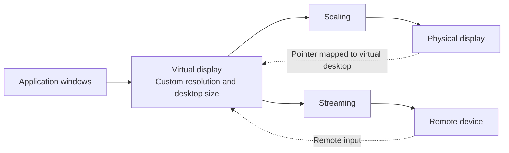
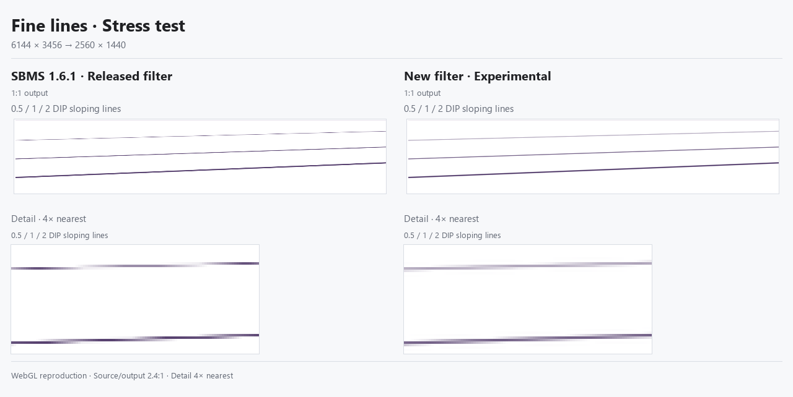
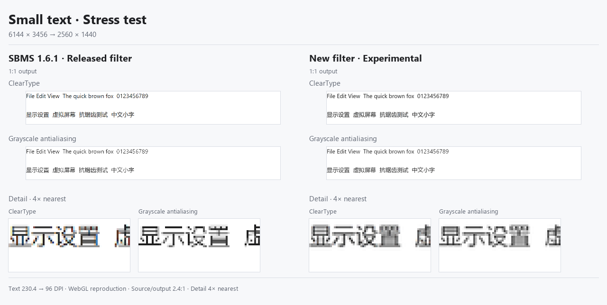
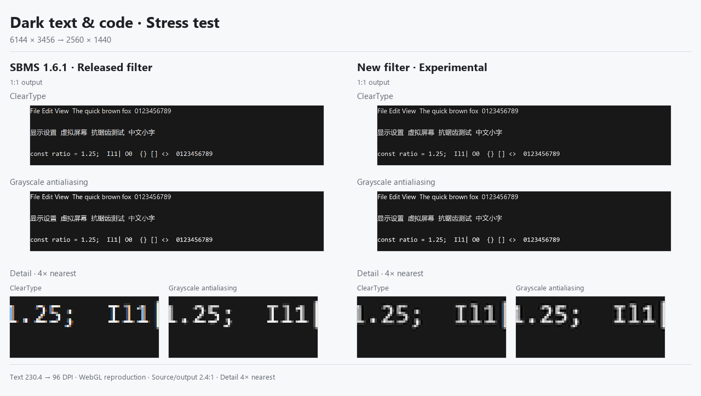
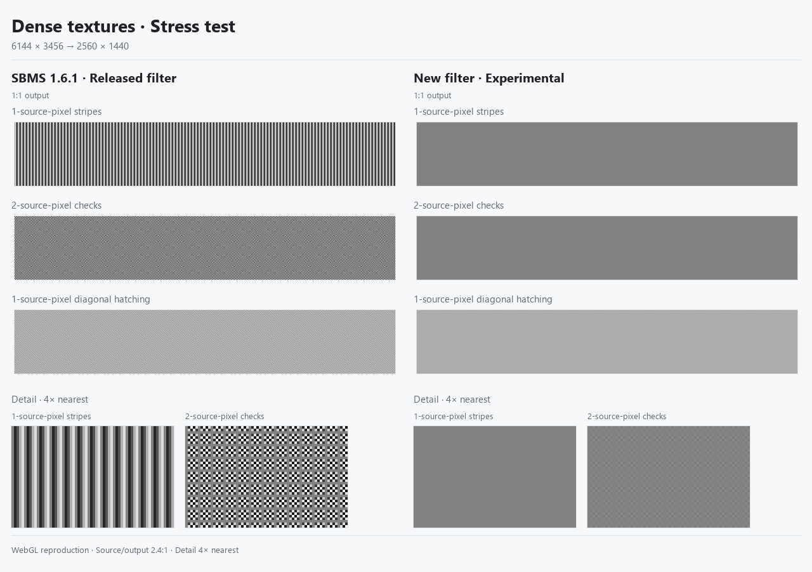
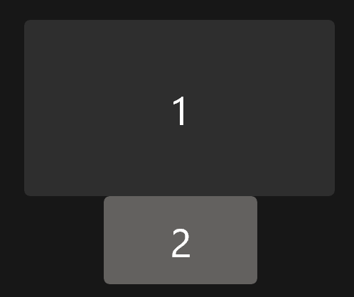
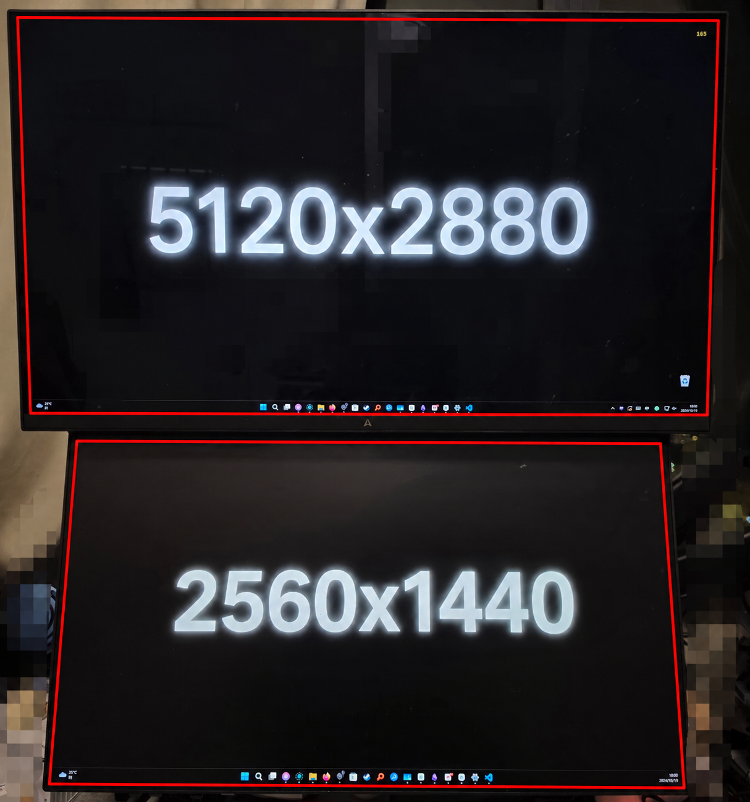
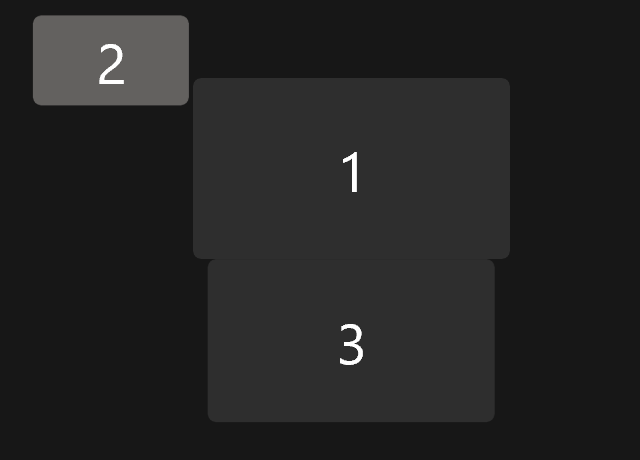
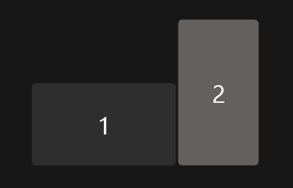
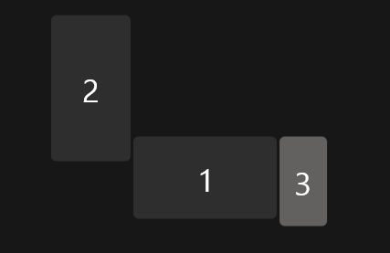

# SBMS

[简体中文](README.md) · [Download](https://github.com/EvanZhu0721/SBMS/releases/latest) · [Documentation](docs/README.md#english)

## Contents

- [Overview](#overview)
- [Problem](#problem)
- [How it works](#how-it-works)
- [Demonstrations](#demonstrations)
- [Performance](#performance)
- [Getting started](#getting-started)
- [Technical documentation](docs/README.md#english)
- [Acknowledgments](#acknowledgments)
- [License](#license)

## Overview

SBMS stands for "SBMS bridges multiple screens". It uses virtual displays to improve cooperation between Windows displays with different pixel densities. It can also work with Sunshine to use another device, such as a laptop, tablet or phone, as an extended desktop display.

## Problem

SBMS addresses common mixed-display problems:

1. Window redraws and inconsistent pointer movement when moving between different display scales.
2. Text clarity at fractional scales.
3. Calculating suitable resolutions across multiple displays.
4. Desktop geometry that does not match physical screen sizes and positions.
5. Creating an independent virtual desktop output for Sunshine streaming.

## How it works

### System overview

### Virtual desktop and scaling

SBMS gives Windows a virtual monitor, places application windows on it, then scales its picture to fill the physical monitor you choose. This lets you set the desktop resolution used by your applications separately from the physical monitor's resolution.<a id="principle-ref-1" href="#principle-note-1">1</a>

### Input, windows, and layout restoration

You keep viewing and interacting with windows on the physical screen; SBMS translates mouse positions to the corresponding positions on the virtual screen. Starting a mapping moves ordinary windows from the target monitor; stopping restores the windows and the original display layout.<a id="principle-ref-2" href="#principle-note-2">2</a>

### Sampling and filtering

The quality filter combines Lanczos3-based reduction, antiringing and adaptive color-fringe suppression to improve text, lines and fine patterns. It costs more GPU time than the legacy filter. When no discrete GPU is detected, SBMS automatically falls back<a id="principle-ref-3" href="#principle-note-3">3</a> to high-performance sampling by default; you can also select it manually in settings. The legacy filter uses area averaging with simpler fringe suppression for reductions of up to 2× on both axes, and bilinear sampling otherwise.

The following stress cases use **6144×3456 → 2560×1440**: SBMS 1.6.1 sampling on the left, the new filter on the right; native output pixels above, matching 4× details below. These are WebGL reproductions of the sampling algorithms, not installed-application screenshots; the Experimental label dates from their creation. The legacy filter uses bilinear sampling at this ratio, so the differences are not representative of every everyday workload. [Methods and tradeoffs](docs/sampling-stress.md).

<table>
  <tr>
    <td align="center" valign="top" width="50%">Fine diagonal lines 
      
    </td>
    <td align="center" valign="top" width="50%">Reading text 
      
    </td>
  </tr>
  <tr>
    <td align="center" valign="top" width="50%">Dark code 
      
    </td>
    <td align="center" valign="top" width="50%">Dense textures (synthetic stress samples) 
      
    </td>
  </tr>
</table>

### Streaming output

The virtual screen can also be streamed to another device through [Sunshine](https://github.com/LizardByte/Sunshine)<a id="principle-ref-4" href="#principle-note-4">4</a> and controlled with Moonlight. A laptop or tablet can then show its own extended desktop instead of repeating the main monitor's picture.

Each Stream only output has its own Sunshine instance and connection port. Local mirror outputs do not start Sunshine. After startup, add the address shown by SBMS in Moonlight and use Open Sunshine to open that instance's web panel for pairing. Stopping the mapping also stops its instance.<a id="principle-ref-5" href="#principle-note-5">5</a>

1. a C++ UMDF indirect display driver exposes the virtual monitor through WDF/IddCx. Local mapping captures the virtual output with Desktop Duplication, then scales and presents it through a D3D11 pixel shader in a full-screen window on the target monitor. "Virtual desktop" here means the extended desktop area on a virtual monitor, not the multiple-desktop feature in Windows Task View. <a href="#principle-ref-1" title="Back to text">↩</a>

2. the local input path transforms mouse coordinates from the target display region into the virtual source region and controls the real Windows pointer. Window migration also handles eligible windows created during a mapping session. The session lifecycle records and restores the relevant window and display-topology state. <a href="#principle-ref-2" title="Back to text">↩</a>

3. Automatic fallback selects the default only when no sampling mode has been set manually. SBMS enumerates DXGI adapters, excludes software adapters, and queries <code>D3D11_FEATURE_DATA_D3D11_OPTIONS2.UnifiedMemoryArchitecture</code>. A discrete GPU is considered present only if at least one hardware adapter explicitly reports non-unified memory (UMA=false); otherwise the legacy high-performance filter is the default. Failed or unknown queries do not establish the presence of a discrete GPU. This is a driver-reported heuristic, not a classification by GPU name or VRAM capacity, and it does not identify the GPU actually used for rendering. The result is cached after the first query in each process and is not refreshed on GPU hot-plug events. Correct matching to the active hardware or its performance is not guaranteed for dual-GPU systems that default to integrated graphics, hybrid routing, external-GPU hot-plugging, or incorrect driver reports. Select the sampling mode manually according to actual performance; restart SBMS after hardware changes to rerun detection. <a href="#principle-ref-3" title="Back to text">↩</a>

4. Sunshine is optional third-party streaming software, not a required dependency for SBMS local display mapping. Install it separately to use Sunshine streaming. SBMS provides integration and instance management; Sunshine/Moonlight handle encoding, network transport, and remote input. <a href="#principle-ref-4" title="Back to text">↩</a>

5. A Stream only output creates a virtual monitor without a local physical-screen mapping. Once the virtual output is ready, SBMS starts a Sunshine instance bound to it. Instance isolation: SBMS reuses the installed Sunshine executable and stores separate configuration, pairing state, web credentials, certificates, application lists, and logs for each output group under <code>%LOCALAPPDATA%\SBMS\sunshine\group-&lt;id&gt;</code>. The <code>output_name</code> setting selects the display to capture. Port allocation: preferred base ports start at 54321 and increase by 27 per output slot. SBMS checks the required TCP/UDP port family and advances to another family if a port is occupied. Startup and shutdown: a background manager invokes the instance-management script to generate configuration, launch a hidden process, and record its PID, port, and configuration path. Connection details are reported after a service-port readiness check; failed startups clean up the new process and report the error. Stopping the mapping or exiting normally verifies and terminates managed instances, removes their runtime records, and retains pairing state and credentials for subsequent sessions. Streaming responsibilities: Sunshine/Moonlight handle encoding, transport, and remote input; SBMS manages the virtual displays and Sunshine instances. <a href="#principle-ref-5" title="Back to text">↩</a>

## Demonstrations

### Multiple displays with different sizes and pixel densities

24-inch 2K display + 27-inch 4K display.

  

  

  After SBMS 
  

### Laptop and desktop monitor

Laptop display + desktop monitor.

  

  

### Independent streaming desktop

Desktop PC + laptop as an extended display. Images to follow.

## Performance

SBMS reduces overhead through dirty-region updates, resource reuse and dynamic refresh. Actual resource use depends on source and target resolutions, refresh rate, output group count, changing content and sampling mode.

The quality filter adds processing passes and intermediate textures, so legacy memory and bandwidth estimates do not describe its cost. Integrated GPUs also share system memory bandwidth with the CPU. If performance is insufficient, enable high-performance sampling or reduce virtual resolution, refresh rate or the number of active output groups. See [Rendering and sampling](docs/rendering.md) for the rendering paths.

## Getting started

### Download and installation

Supports Windows 10 version 2004 or later and Windows 11. Use the x64 installer from [Releases](https://github.com/EvanZhu0721/SBMS/releases/latest) and follow its prompts to install the application and virtual display driver.

The current self-signed build requires approval to trust the driver certificate. Setup does not change Secure Boot or driver-signature enforcement settings. Certificate trust remains after uninstall.

### Local displays

1. Choose a display under `Shared reference`. All output groups share it. A higher-pixel-density display is usually the preferable reference.
2. Add an output group and select the physical display to map.
3. Check the screen dimensions and correct them under `Screen size` if necessary. Start with `Physical` under `Sizing`.
4. Click `Start mapping`, then arrange the displays in Windows display settings to match their physical positions.

Add output groups for additional displays. Click `Stop and restore` to stop mapping and restore windows and the display layout.

### Streaming displays

1. Install Sunshine on the host and Moonlight on the receiving device.
2. Add an output group, select `Stream only` and configure the target screen.
3. Click `Start mapping` and add the address shown by SBMS as a host in Moonlight.
4. Click `Open Sunshine` to open that instance's web panel, complete pairing and connect.

Each streaming output group has its own connection address. Use the information shown for the corresponding group.

## Acknowledgments
First of all, thank you for taking the time to read this far.

This is my first github repo which release to public and hope that can help you or inspire you in someway if you are also a developer.

Thanks for all of my friends, especially Jerry & Tony, who shared their ideas and advices with me. thanks for Mr Berti who is my CSA teacher. thanks for my parents who support me. thanks for my brother Eason who lives in the US and help me recharge my openAI account. thanks for Tibo who reset my token for several times. thanks for all of the agents and subagents who change my ideas into the program. thanks for the Chinese GFW which really trained me to become an expert in communication engineering. thanks for all the open-source developers, reading your codebases really brings me lots of idea.

BTW I subscribe CodexPro500 XD

$${\color{black}of \space course \space I \space still \space love \space you}$$

## License

[LICENSE](LICENSE)
