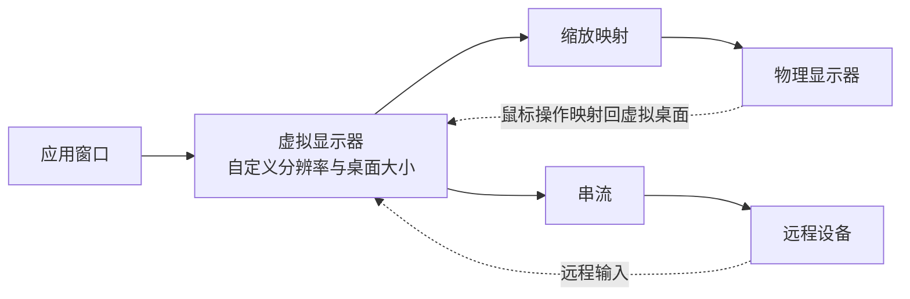
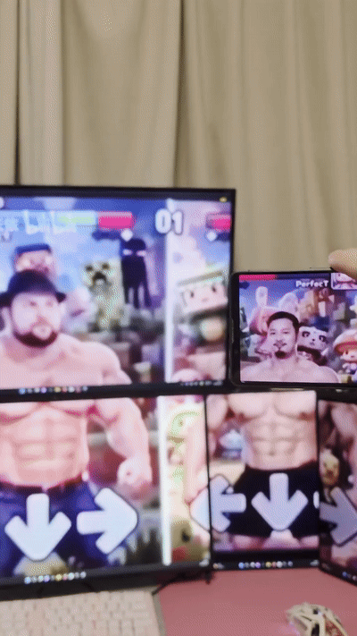

# SBMS

> [!TIP]
> 如果本项目帮到了您，请给仓库点个 Star，这是我维护这个开源仓库的动力! 如果您有任何疑问, 遇到了任何问题TAT, 恳请CtrlA + CtrlC一下日志, 给本仓库提个issue, 我一定会尽量改进! 也非常欢迎各路dalao的PR!

[English](README.en.md) · [下载](https://github.com/EvanZhu0721/SBMS/releases/latest) · [技术文档](docs/README.md#中文)

## 目录

- [简介](#简介)
- [典型问题](#典型问题)
- [工作原理](#工作原理)
- [场景演示](#场景演示)
- [性能](#性能)
- [开始使用](#开始使用)
- [技术文档](docs/README.md#中文)
- [致谢](#致谢)
- [许可证](#许可证)

## 简介
'SBMS' 的意思是SBMS bridges multiple screens. 也就是连接多个显示器. 众所周知, Linux的mutter等桌面合成器很早就实现了桌面尺寸和渲染分辨率的解绑. 而windows中不同像素密度的多显示器体验即使到了现在也还存在各种问题, [见下](#典型问题).

SBMS致力于解决这些问题, 用一个折衷的外挂虚拟显示器方案改善多屏协同体验. 也可以和开源串流软件sunshine协同, 将任何设备 (笔记本, 平板, 手机甚至是switch) 作为windows桌面的副屏.

## 典型问题
我们解决了的问题如下:
1. 设置不同缩放导致的窗口重绘, 鼠标速度不统一问题.
2. 设置非整数缩放导致的文本清晰度问题.
2. 多显示器缩放比例计算困难问题.
3. 显示器PPI不同导致的桌面布局和显示器物理尺寸比例不一致问题 (屏幕对不齐, 光标跳变...).
4. Sunshine原生串流输出只支持复制物理显示器而不能作为副屏问题.

## 工作原理

### 总体示意图

### 虚拟桌面与缩放映射

SBMS 先让 Windows 识别出一块 "虚拟显示器", 把应用窗口放到这块屏幕上, 再将画面缩放后显示在你选择的实体显示器上. 这样就能单独设置应用使用的桌面分辨率, 而不必让它与实体屏幕的分辨率相同.<a id="principle-ref-1" href="#principle-note-1">1</a>

### 输入, 窗口与布局恢复

你无需改变使用习惯, 仍然直接在实体屏幕上看画面, 交互; SBMS 会把鼠标位置对应到虚拟屏幕中的位置, 并尽量处理所有边界情况. 开始映射时, 它会迁移目标屏幕上的普通窗口; 停止时, 再恢复窗口和原来的显示布局.<a id="principle-ref-2" href="#principle-note-2">2</a>

### 采样和滤波

在2.0.0版本的更新中, SBMS推出了新的采样滤波算法. **基于lanczos3等算法**, 并引入定制的**振铃抑制**, 自适应**彩边抑制**算法. 大幅提高了**清晰度**, **锐度**, 减少**彩边**, **锯齿**和**摩尔纹**. 通过多轮对抗样本攻击反馈并针对性优化, 新算法保证了极低的误判率.

毫无疑问的是较高的性能开销, 参考推荐硬件是RTX4060 (包括laptop) + ddr4双通道内存. 当SBMS没有识别到独立显卡时, 会自动回退<a id="principle-ref-3" href="#principle-note-3">3</a>旧版本的高性能采样方案. 在现代集成显卡上表现良好. 高性能采样方案可以在设置中手动开启.

高性能采样方案旧版采用 **面积平均与双线性插值, 按缩放比例切换**, 去彩边算法非自适应, 且较简单.

以下为 **6k → 2.5k** 的压力场景: 左侧是高性能, 右侧是新版; 上方为输出原像素, 下方为同一区域的 4× 特写. 图片由采样算法的 WebGL 复现生成, 并非安装版截图, 供参考[测试方法与取舍](docs/sampling-stress.md).

<table>
  <tr>
    <td align="center" valign="top" width="50%">细斜线 
      
    </td>
    <td align="center" valign="top" width="50%">阅读文字 
      
    </td>
  </tr>
  <tr>
    <td align="center" valign="top" width="50%">深色代码 
      
    </td>
    <td align="center" valign="top" width="50%">密集纹理 (合成压力样本) 
      
    </td>
  </tr>
</table>

### 串流输出

虚拟屏幕也可以通过 [Sunshine](https://github.com/LizardByte/Sunshine)<a id="principle-ref-4" href="#principle-note-4">4</a> 传到另一台设备上, 用 Moonlight 连接和操作. 这样, 笔记本或平板就能显示一个独立的扩展桌面, 而不只是显示主屏幕的内容.

每组 Stream only 输出都有自己的 Sunshine 实例和连接端口, 本地镜像输出不会启动 Sunshine. 启动后, 使用 SBMS 显示的地址在 Moonlight 中添加主机, 通过 Open Sunshine 打开对应实例的网页面板完成配对; 停止映射时, 对应实例也会停止.<a id="principle-ref-5" href="#principle-note-5">5</a>

1. 虚拟显示器由 C++ UMDF 间接显示驱动通过 WDF/IddCx 提供. 本地映射使用 Desktop Duplication 获取虚拟输出画面, 再通过 D3D11 像素着色器缩放并呈现到目标显示器上的全屏窗口. 这里的 "虚拟桌面" 指虚拟显示器承载的扩展桌面区域, 不是 Windows 任务视图中的多桌面功能. <a href="#principle-ref-1" title="返回正文">↩</a>

2. 本地输入路径将目标显示区域中的鼠标坐标转换到虚拟源区域, 并控制 Windows 的真实指针. 窗口迁移也会处理映射期间新出现的符合条件的窗口; 会话生命周期负责记录并恢复相关窗口与显示拓扑状态. <a href="#principle-ref-2" title="返回正文">↩</a>

3. 自动回退仅用于未手动指定采样模式时的默认选择. SBMS 通过 DXGI 枚举显卡, 排除软件适配器, 并查询 D3D11 的 <code>D3D11_FEATURE_DATA_D3D11_OPTIONS2.UnifiedMemoryArchitecture</code>: 至少一张硬件显卡明确报告非统一内存架构 (UMA=false), 才视为检测到独显; 否则默认使用旧版高性能采样, 查询失败或结果未知也不能作为检测到独显的依据. 这是基于驱动报告的启发式判断, 不按显卡名称或显存容量分类, 也不确认实际渲染所用显卡. 检测结果在进程内首次查询后缓存, 不随运行中的显卡热插拔更新; 对于默认使用核显的双显卡, 混合显卡路由, 外置显卡热插拔或驱动报告异常等情况, 不保证自动选择与实际运行硬件, 性能匹配. 请按实际表现手动选择采样模式; 硬件变化后需重启 SBMS 才会重新检测. <a href="#principle-ref-3" title="返回正文">↩</a>

4. Sunshine 是可选的第三方串流软件, 不是 SBMS 本地显示映射功能的必需依赖. 使用 Sunshine 串流时需另行安装; SBMS 提供对接与实例管理, 画面编码, 网络传输和远程输入由 Sunshine/Moonlight 完成. <a href="#principle-ref-4" title="返回正文">↩</a>

5. Stream only 输出创建虚拟显示器, 不建立本地物理屏幕映射; 虚拟输出就绪后, SBMS 启动与该输出绑定的 Sunshine 实例. 实例隔离: 复用已安装的 Sunshine 可执行文件, 在 <code>%LOCALAPPDATA%\SBMS\sunshine\group-&lt;id&gt;</code> 为各输出组分别保存配置, 配对状态, 网页凭据, 证书, 应用列表和日志, 并通过 <code>output_name</code> 指定捕获的显示器. 端口分配: 默认从 54321 起按输出槽位以 27 为步长分配基础端口, 检查所需 TCP/UDP 端口组; 遇到占用时继续向后寻找可用端口组. 启动与停止: 后台管理线程调用实例管理脚本, 生成配置, 隐藏启动进程并记录 PID, 端口和配置路径; 检查服务端口就绪后上报连接信息, 启动失败则清理本次进程并报告错误. 停止映射或正常退出时, 核验受管进程身份后终止实例, 移除运行记录, 但保留配对状态和凭据供下次使用. 串流分工: Sunshine/Moonlight 负责画面编码, 传输与远程输入, SBMS 负责虚拟显示器及上述实例管理. <a href="#principle-ref-5" title="返回正文">↩</a>

## 场景演示

### 不同尺寸与像素密度的多屏协作

24寸2k显示器 + 27寸4k显示器.

  

  

  使用 SBMS 后 
  

### 笔记本与桌面显示器

笔记本显示输出 + 桌面显示器.

Before:

  

After:

  

### 独立串流桌面

台式机 + 笔记本作为副屏.

懒. 后续补图.

### 多组输出组合

 ~~解耦渲染的合成才是王道, 你那兼容的屎山根本没技巧.~~

  

## 性能

SBMS 通过脏区域更新, 资源复用和动态刷新减少开销. 实际占用取决于源与目标分辨率, 刷新率, 输出组数, 画面变化和采样模式.

新版滤波使用额外的处理步骤和中间纹理, 因此不能沿用旧版的显存及带宽估算. 集显还会与 CPU 共享系统内存带宽. 性能不足时, 可开启高性能采样, 或降低虚拟分辨率, 刷新率及同时运行的输出组数. 具体路径见[渲染与采样](docs/rendering.md).

## 开始使用

### 下载与安装

支持 Windows 10 2004 及以上版本和 Windows 11, 使用 x64 安装包.

从 [Releases](https://github.com/EvanZhu0721/SBMS/releases/latest) 下载并运行安装包, 按提示安装应用和虚拟显示器驱动.

当前自签名版本需要你确认信任驱动证书; 安装器不会修改 Secure Boot 或驱动签名强制设置, 证书信任在卸载后仍会保留.

### 本地多屏

1. 在 `Shared reference` 中选择参照屏, 所有输出组共用这一参照. 通常建议选择像素密度较高的屏幕.
2. 添加输出组, 选择需要映射的实体显示器.
3. 检查屏幕尺寸. 识别不准确时, 在 `Screen size` 中修正; `Sizing` 可先保持 `Physical`.
4. 点击 `Start mapping`, 然后在 Windows 显示设置中按实际摆放调整屏幕位置.

需要映射更多屏幕时, 继续添加输出组. 点击 `Stop and restore` 停止映射并恢复窗口与显示布局.

### 串流副屏

1. 在主机安装 Sunshine, 在接收设备安装 Moonlight.
2. 添加输出组并选择 `Stream only`, 配置目标屏幕参数.
3. 点击 `Start mapping`, 使用 SBMS 显示的地址在 Moonlight 中添加主机.
4. 点击 `Open Sunshine` 打开对应实例的管理页面, 完成配对后连接.

每个串流输出组都有独立的连接地址, 请使用对应组显示的信息.

## 致谢
First of all, thank you for taking the time to read this far.

This is my first github repo which release to public and hope that can help you or inspire you in someway if you are also a developer.

Thanks for all of my friends, especially Jerry & Tony, who shared their ideas and advices with me. thanks for Mr Berti who is my CSA teacher. thanks for my parents who support me. thanks for my brother Eason who lives in the US and help me recharge my openAI account. thanks for Tibo who reset my token for several times. thanks for all of the agents and subagents who change my ideas into the program. thanks for the Chinese GFW which really trained me to become an expert in communication engineering. thanks for all the open-source developers, reading your codebases really brings me lots of idea.

BTW I subscribe CodexPro500 XD

$${\color{black}of \space course \space I \space still \space love \space you}$$

## 许可证
本项目
[LICENSE](LICENSE)
