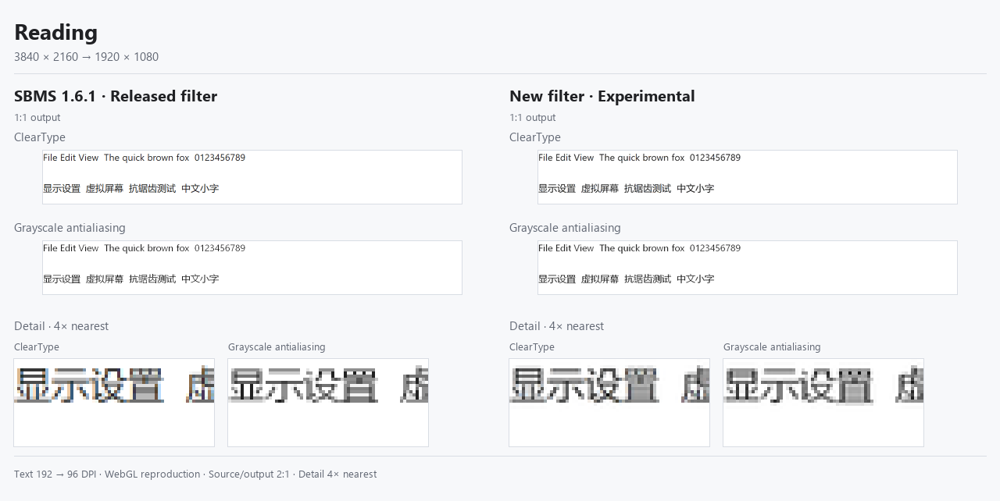
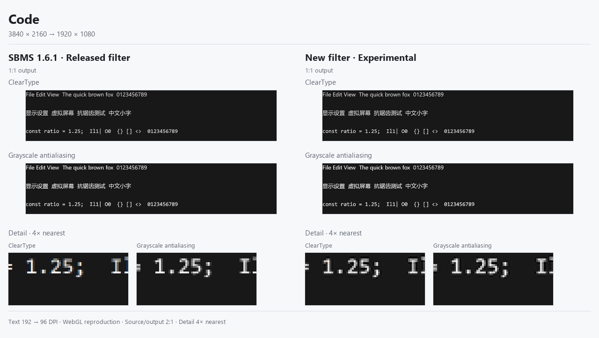
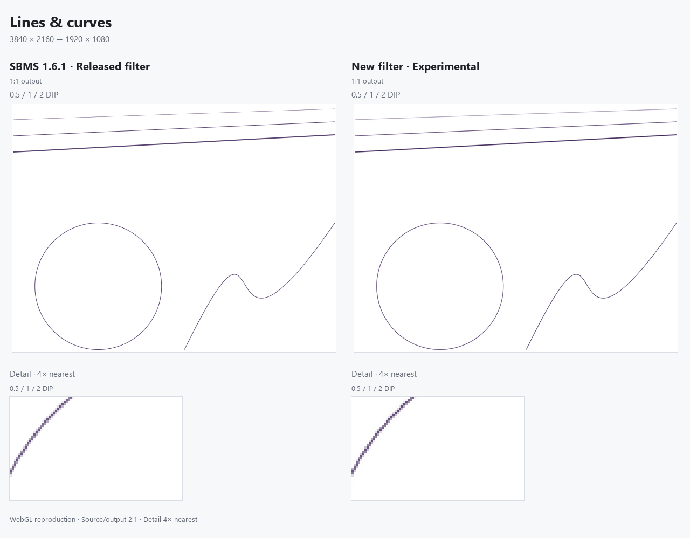
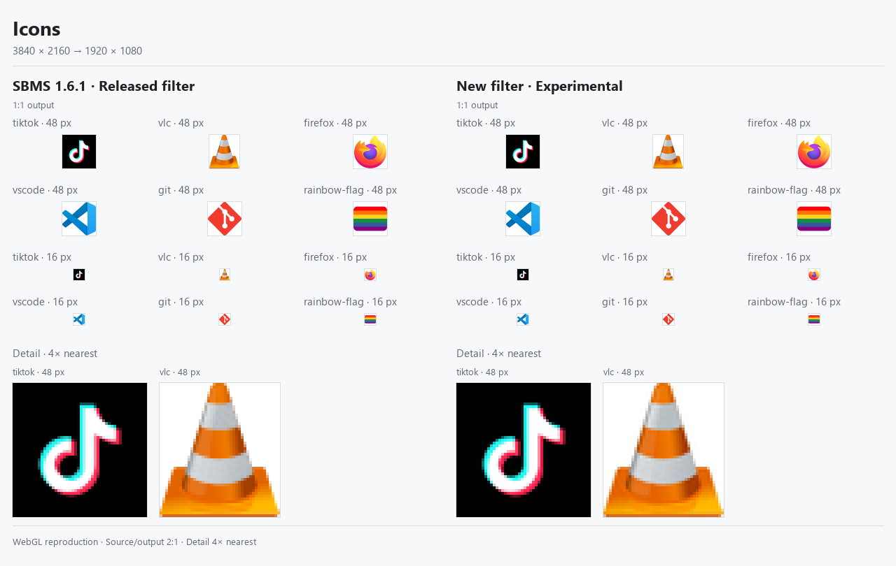
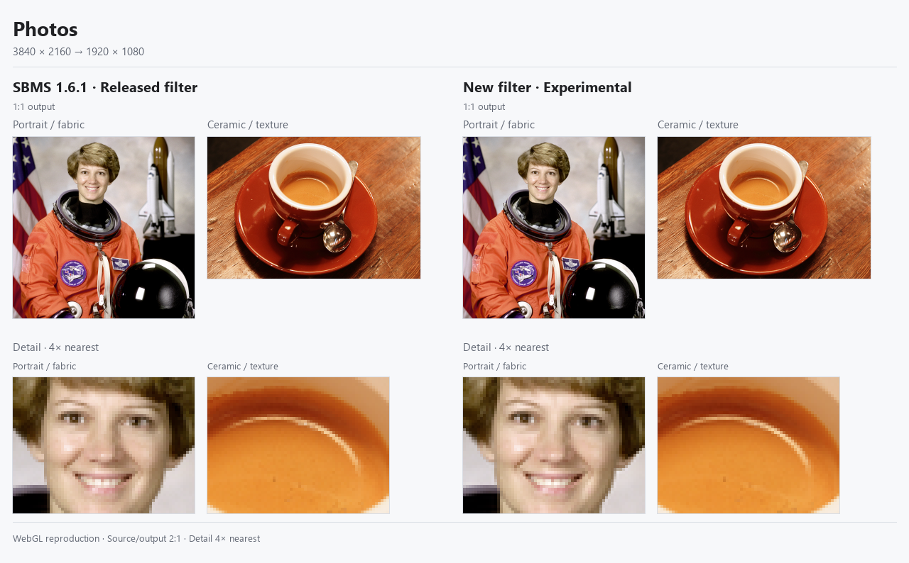

# 采样场景对比

这组 README 素材按内容分为阅读、代码、线条、图标和照片，统一采用高 DPI 源画面缩小到目标屏幕的场景。放大试验保留在技术记录中，不列入这组展示。

另有[重度缩小压力场景](sampling-stress.md)：统一采用 6144×3456 → 2560×1440，比较密集纹理、细斜线、小字和真实彩色图标。该组跨过发布版的面积平均适用边界，不能将其较大差异泛化到本页的常规场景。

左侧复现 [SBMS v1.6.1 发布版](https://github.com/EvanZhu0721/SBMS/releases/tag/v1.6.1)的采样公式；右侧为新版实验方案。发布提交为 `3c1ae5bb054c5613be530659360cbb75b95f0e31`，已核对其 shader 与当前基线一致，见[版本审计](../work/sampling-lab/release-baseline.json)。

## 共同条件

- 所有图都使用 `3840×2160 → 1920×1080`，两侧共享同一源图、同一位置。区别来自内容，不来自为各组挑选不同倍率。
- 发布版在此条件下使用精确面积平均及原有去彩边；新版使用选择性去彩边和按缩小比例扩展采样范围的 Lanczos3。
- 原生 Windows 文字分别以 ClearType 和灰度抗锯齿绘制；源目标 DPI 为 192，24 px em 缩到 12 px em。素材来自 Win32 测试窗口，不是 Word、VS Code 等应用截图。
- 图标先按指定源尺寸光栅化，两侧共用；照片保持原始 `512×512` / `600×400` 像素，只经过本次最终采样，没有先缩小照片。
- 每图上方按输出原像素 1:1 放置，下方是相同区域的 4× 最近邻特写。请打开原图查看；网页整体缩图会影响判断。
- 这是 WebGL 对发布公式的复现，不是两个安装版实拍。原生 D3D11 硬件插值可能有舍入差异；比较区域均远离纹理边界。

## 阅读

中文细笔画、英文数字与浅底边缘。ClearType 样本的残余色度总量在三个源位置下比发布版减少 **78.91%–79.46%**。灰度样本展示字形和字重变化，不把“没有彩边”的输入也算作去彩边收益。



## 代码与深色界面

白字、中文与 `Il1| O0 {} [] <>` 等易混字符。ClearType 整个展示区域的残余色度减少 **80.37%–80.46%**；这是该文字区域的色度指标，不是“画质提升 80%”。边缘仍可能出现字重改变或明暗振铃。



## 线条与曲线

0.5 / 1 / 2 DIP 斜线、圆弧和贝塞尔曲线，源画面按 200% 布局密度重新绘制。该组是合成几何测试，用来观察轮廓连续性、线宽和光晕。线条本来就是紫色，不能把色度下降当作改善标准。



## 图标

TikTok、VLC、Firefox、VS Code、Git 和彩虹旗，分别展示 48 px 与 16 px 输出。这里检查真实颜色、装饰彩边与小图标形状是否被破坏；图标色度变化不计作去彩边收益，也不声称图标逐像素无损。



## 照片与纹理

人像、头发、衣料、陶瓷和木纹。正常尺寸下差别比文字小，局部特写用来观察锐度和边缘过冲；不因为效果接近就省略这一组。NASA 人像与咖啡照片的来源、作者及使用许可见[素材出处](../work/sampling-lab/assets/corpus/SOURCES.md)。



## 验证与边界

[验证记录](../work/sampling-lab/scenario-exports/verification.json)覆盖 19 个素材条件与 `(0,0)`、`(1,0)`、`(1,1)` 三个整数源位移，共 57 组，9,576 次 CPU/GPU 抽样误差均不超过 1/255；同帧分屏逐像素一致，灰度输入没有引入颜色。两张照片进入源纹理的区域均与原始解码像素逐字节一致。

PNG 只使用共同零位移的 GPU 输出，图中位置与特写记录在[导出清单](../work/sampling-lab/scenario-exports/manifest.json)。排版脚本检查原尺寸贴图、最近邻细节与 PNG 保存后像素均未改变。五图均已逐张目视检查。

收益主要体现在文字彩边与采样轮廓；负瓣滤波仍可能带来振铃、字重变化及真实彩色边缘变化。本组不衡量帧率、实际串流编码、HDR 或所有显示设备，也不表示新版已集成到发布版。

## README 引用

以下路径相对仓库根目录。配文宜明确“发布版采样公式与实验方案”，并链接本页；无需展示放大实验。

```markdown


```

英文配文：

> SBMS 1.6.1 sampling formula versus the experimental filter, grouped by content. All scenes use the same 2:1 reduction. Native Windows text is rasterized at 192 DPI for 96-DPI output; photos retain their original source pixels. Each figure includes native output and a shared 4× nearest-neighbor detail. WebGL reproduction, not released-application screenshots.

复现：

```powershell
node work/sampling-lab/export-scenario-comparison.cjs
python work/sampling-lab/build-scenario-comparison.py
```
