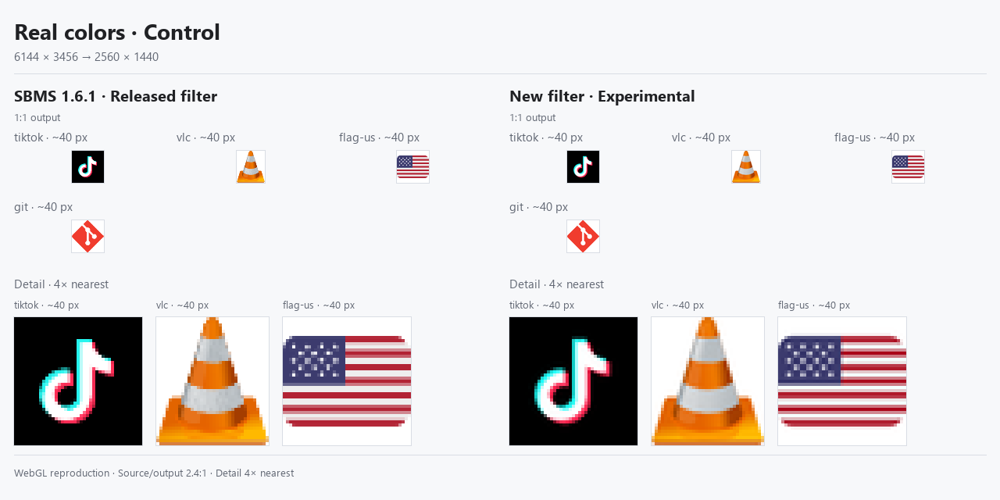

# 采样压力场景

这组选择更容易暴露缺陷的内容：密集纹理、细斜线、小字和带真实彩色细节的图标。五张图均使用 **6144×3456 → 2560×1440**，不是为每张图挑选不同倍率。原来的[常规场景](sampling-scenarios.md)继续保留。

这比上一组 2:1 缩小更苛刻，也跨过了发布版的算法分支边界：SBMS 1.6.1 仅在双轴缩小且每轴不超过 2 倍时使用面积平均，这里的 2.4:1 实际走双线性。新版仍使用选择性去彩边和按缩小率扩展采样范围的 Lanczos3。因此，本组不能代表“所有日常场景都有同样大的提升”。基线依据见[发布版审计](../work/sampling-lab/release-baseline.json)。

两侧使用同一源像素、位置和输出大小；上方保留输出原像素，下方为相同区域的 4× 最近邻特写。这是发布版采样公式的 WebGL 复现，不是安装版截图。

## 密集纹理


这是差异最明显的一组。输入是既有测试图中的 1 源像素条纹、2 源像素棋盘和细斜向排线，属于**合成压力样本**，不是实拍布料。它们模拟织物、百叶窗、网格等密集纹理容易触发的采样问题，但不能代替真实照片验证。

这些输入包含超过输出可分辨频率的图案。左侧的强烈条纹、棋盘和交叉花纹包含混叠；右侧趋于平均灰色，表示压低无法可靠表达的高频，不是恢复了每条线。对于需要逐根检查排线或像素的任务，应放大内容或提高输出分辨率。

共同零位移下，区域内编码亮度的标准差如下，单位为 0–255：

| 样本 | 发布版 | 新版 |
|---|---:|---:|
| 1 源像素条纹 | 64.63 | 0.00 |
| 2 源像素棋盘 | 75.11 | 3.78 |
| 细斜向排线 | 27.85 | 1.50 |

这里用标准差描述假花纹的强度；它不是通用画质评分，不能套到照片或文字上。

## 细斜线


0.5 / 1 / 2 DIP 的斜线按 240% 布局密度重新绘制，可对应图表、矢量图和工程图中的细边。发布版的线条有明显明暗起伏和局部变细，新版更连续。新版同时会改变线宽和边缘对比度；滤波过冲仍存在。

## 小字与深色代码


文字使用[独立的 240% 原生 Windows GDI 捕获](../work/sampling-lab/assets/text-capture/adaptive/README.md)。源目标 DPI 为 230.4，GDI 将 28.8 px em 取整为 29 px，输出约 12.083 px；没有拿 100% 截图硬缩成无法阅读的小字。来源是测试窗口，不是办公软件或编辑器截图。

每张都保留 ClearType 和独立绘制的灰度抗锯齿对照。三个固定源位置下，ClearType 阅读区域的残余色度总量减少 **90.05%–90.63%**，深色文字区域减少 **88.67%–89.49%**。指标只描述彩边，不能称为“画质提高 90%”。

在原尺寸下，新版的细笔画和代码字符边缘更柔和。特写中也能看出部分笔画的峰值、字重和光晕变化；喜欢硬边的人未必在每一行文字上都更喜欢新版。

## 真实颜色对照



TikTok、VLC、美国旗帜和 Git 图标均先以 96 源像素光栅化，两侧采样至约 40 输出像素。完整覆盖裁剪因像素中心对齐包含 41 px 边界，并非额外缩放。出处见[原素材记录](../work/sampling-lab/assets/corpus/SOURCES.md)及[导出清单](../work/sampling-lab/stress-exports/manifest.json)。

美国旗帜的细条、星点与 TikTok 的装饰彩边作为真实图案对照。新版没有把这些图案整体去色，但颜色、条纹粗细和局部对比度确实发生变化；本组不证明真实颜色逐像素无损。

## 验证与复现

- [导出清单](../work/sampling-lab/stress-exports/manifest.json)记录所有源区域、输出区域与共同特写；[像素图集](../work/sampling-lab/stress-exports/pixels.png)保留两侧原始 GPU 输出。
- [验证结果](../work/sampling-lab/stress-exports/verification.json)覆盖 12 个素材条件 × 3 个源位移，共 36 组。6,048 次 CPU/GPU 抽样误差均不超过 1/255；分屏像素一致，灰度输入没有增加颜色。
- 图中使用共同零位移。其他两个位置用于验证，不从它们中逐图挑选最佳效果。
- 五张图均经过原像素、特写、PNG 解码一致性检查和逐张目视检查；原先五张常规图使用修改后的排版代码在内存重建，像素保持一致。
- 本次只扩展比较材料，没有修改采样算法或产品代码。未测原生渲染性能、串流编码、HDR 或运动视频质量。

```powershell
node work/sampling-lab/export-scenario-comparison.cjs --stress
python work/sampling-lab/build-scenario-comparison.py --prefix stress
```

README 中建议优先展示细斜线和原生文字，把密集纹理明确放在“压力测试”中。后者视觉差距最大，但其不可分辨高频并不代表普通界面的常态。
